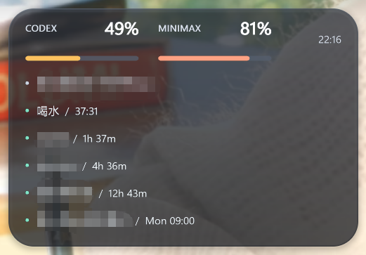

# SeeUsage

[English](README.md)

SeeUsage 是一个极轻量的 Codex 与 MiniMax 用量工具。它没有 WebView、数据库、
遥测，也不会内置或保存账户凭证。



## 功能

- 在 Windows 任务栏上方常驻一个紧凑、可拖动的液态玻璃额度面板。
- 以自适应多列布局显示纪要和近期提醒。
- 支持延时、固定间隔、每日、每周、每月、阳历固定日和农历固定日提醒。
- 在 Windows 系统托盘或 macOS 菜单栏显示额度摘要。
- 可从 **显示内容** 菜单中分别显示或隐藏 Codex 与 MiniMax。
- 支持跟随系统，或即时切换英语、简体中文、繁体中文、日语、韩语、西班牙语、
  法语和德语，无需重启。
- 默认每三分钟刷新，也可以从托盘菜单立即刷新。
- 服务不可用时保留最后一次成功数据，并明确标记为过期数据。
- 根据最低剩余额度将托盘圆环显示为绿色、琥珀色或红色。
- 使用操作系统的当前用户机制设置开机启动。
- 通过 `SeeUsage --once` 输出规范化 JSON，便于诊断和脚本调用。

Windows 桌面额度条默认固定在其他窗口最前，不抢焦点，也不会出现在任务栏或
`Alt+Tab` 中。可从 HUD 或托盘右键菜单切换 **固定 HUD 在最前**，选择会持续保存。
拖动额度条任意位置即可移动，位置会自动保存。右键点击 HUD 或托盘图标，可以
添加和删除纪要与提醒，也可以隐藏 HUD 或重置位置。HUD 只按内容所需扩展，项目
较多时自动分列。纪要默认显示在提醒之前，提醒内部按紧迫性排序；即将到期的提醒
显示为琥珀色。
下次时间超过两天的提醒默认不占用 HUD 空间；可在右键提醒菜单中切换
**显示两天后的提醒**，显示或再次隐藏这些提醒。

提醒可以选择若干分钟、小时、天或周后触发，也可以按这些单位固定间隔循环；
日历模式支持固定日期时间、每日、工作日、周末、每周单日、每周多个指定日、
每月指定日期、每月最后一天，以及每年固定的阳历或农历日期（支持农历闰月）。
提醒到期后不再弹窗，而是在 HUD 中
持续高亮并交替闪烁。点击 Windows HUD 中的到期项即可确认；右键该项可以直接选择
**标记下次已完成**，提前把下一次标记为完成。托盘或菜单栏的提醒菜单
也提供相同操作。逾期提醒在重启后仍保持待确认状态；周期提醒只在确认或跳过后推进，
固定间隔不会因延迟确认而逐次漂移。

## 运行要求

- x86_64 架构的 Windows 10 或更高版本，或 Apple 芯片上的 macOS 12 或更高版本。
- 已登录且可从 `PATH` 调用的 Codex CLI。
- 已认证、支持 `mmx quota show` 的
  [MiniMax CLI](https://github.com/MiniMax-AI/cli)。
- SeeUsage 会检查 CLI 文件是否可能被 `Users`、`Authenticated Users` 等宽泛
  本地组替换；遇到这类路径时会先请求用户确认。

缺少其中一个服务不会影响另一个服务。Codex 数据通过官方记录的
[Codex App Server](https://learn.chatgpt.com/docs/app-server) 本地协议读取；
MiniMax 数据来自 `mmx quota show --output json --quiet`。

## 构建与运行

安装稳定版 Rust 工具链后执行：

```console
cargo run --release
```

只查询一次并输出 JSON，不启动托盘：

```console
cargo run -- --once
```

生成 Windows 便携包：

```powershell
./scripts/package-windows.ps1
```

把 Windows 程序安装到当前用户私有目录并启动：

```powershell
./scripts/install-windows.ps1
```

安装脚本不会移动源码目录，只把小体积的可执行文件复制到
`%LOCALAPPDATA%\Programs\SeeUsage`，并从程序及设置目录移除其他本地用户
继承到的写权限。便携包内的 `Install-SeeUsage.ps1` 无需 Rust，也可完成
同样的安装。

生成 macOS `.app` 与 zip 包：

```bash
./scripts/package-macos.sh
```

## 配置

SeeUsage 刻意不提供沉重的设置主界面。纪要、提醒及删除操作都放在原生右键菜单
中。可在同一菜单的 **语言** 子菜单中即时切换界面语言，选项会保存在本地
`settings.json`。**显示内容** 子菜单可独立隐藏 Codex 或 MiniMax，并同步作用于
HUD、原生菜单、提示文字、标题和额度警示颜色。该选项只控制显示，两个提供商仍会
在后台正常刷新。以下环境变量用于便携安装或开发场景：

| 变量 | 用途 |
| --- | --- |
| `SEEUSAGE_CODEX_BIN` | 覆盖 Codex 可执行文件或脚本路径。 |
| `SEEUSAGE_MMX_BIN` | 覆盖 `mmx` 可执行文件或脚本路径。 |
| `SEEUSAGE_REFRESH_SECONDS` | 刷新间隔，最低 30 秒。 |

环境变量指定的可执行文件同样会接受路径权限检查。CLI 路径允许宽泛本地组
写入时，托盘程序会针对该提供商和路径显示一次原生安全警告。选择 **Yes**
后会记住该路径并自动刷新；选择 **No** 后，本次运行继续保留缓存数据。
托盘菜单的 **清除 CLI 路径授权** 可以撤销授权。`--once` 不会弹出
授权窗口。PowerShell 包装脚本仍不受支持。Windows 开机启动前，应把
SeeUsage 放入当前用户私有目录。

## 隐私

SeeUsage 只在本地运行。它把认证和网络请求交给现有的 `codex` 与 `mmx`，
不会读取凭证文件，也不会保存 Token 或原始错误文本。缓存只包含规范化后的
百分比、重置时间、模型名称和安全状态码。用户填写的纪要和提醒文案单独保存在
`settings.json` 中，不会发送给任何提供商。

两个提供商使用相互隔离的最小环境：Codex 不会收到 MiniMax Key，MiniMax
不会收到 OpenAI Key，无关敏感变量会被移除。子进程的 `PATH` 只保留经过
权限检查的目录，并从 CLI 自身经过检查或用户明确授权的目录运行。授权信息
只保存规范化后的可执行文件路径，不包含 Key。非交互命令无法读取标准输入，
子进程运行在受控进程组中，输出长度受到限制。登录和 Token 刷新仍由官方
CLI 负责。

- Windows：`%LOCALAPPDATA%\SeeUsage\state.json` 与 `settings.json`
- macOS：`~/Library/Application Support/SeeUsage/state.json` 与
  `settings.json`

退出 SeeUsage 后删除上述数据目录，即可清除用量缓存、纪要、提醒、HUD 位置和
CLI 路径授权。仅删除程序文件不会自动删除这些用户数据。

SeeUsage 与 OpenAI、MiniMax 没有隶属或背书关系，详见 [NOTICE](NOTICE)。

## 许可证

[MIT](LICENSE)
